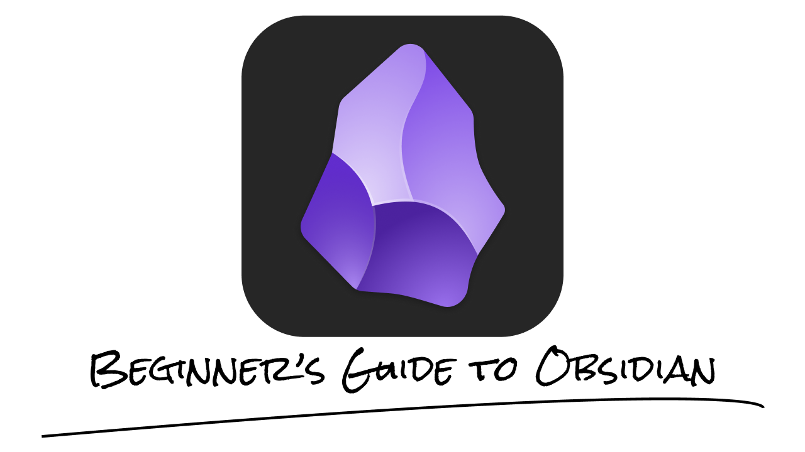

# What are Obsidian and Markdown?

Obsidian is not a cloud service. It is a convenient, polished interface for working with local Markdown (`.md`) text files.

> [!NOTE]
> Main advantages:
> 1. By default, your notes are stored locally on your device, so you can write without an internet connection. They are not tied to an account, but you should still keep backups.
> 2. Markdown notes are plain-text files. They are easy to read and compare in version control because the text and markup are visible in the file. For a comparison with Word, see [this YouTube video](https://youtu.be/7a-YGcVG4_0?si=fE2bQnz8mPMC9bOP).
> 3. Version control is easy to set up, especially with a tool such as GitHub: you can see which lines changed, which files moved, and more.
> 4. Obsidian has many distinctive features: links between notes, a wide range of plugins and themes, and much more.

Remember that all of this is useful only if you want to take notes and store information. Don't need notes? Don't need to store information? Then close this tab.

# How do I use Obsidian? Where can I learn Markdown and about the app's features?

Download Obsidian from the official site: [Download - Obsidian](https://obsidian.md/download)

When you are ready to learn Obsidian, I recommend starting with the guide from its developers. It teaches you Markdown and introduces some of Obsidian's distinctive features. For anything else, visit the official site: [Home - Obsidian Help](https://obsidian.md/help/) or [Obsidian - Sharpen your thinking](https://obsidian.md/).

To open the full guide, find `Sandbox Vault` in the `Manage Vaults` menu. If it is not there, open any folder as a `Vault`, then find the question-mark icon at the bottom of the settings panel and choose `Sandbox Vault`.

> [!TIP]
> As it turned out, this guide is not a complete account of Obsidian's features and, to be honest, it is not the best one: the explanations are very simple. By chance, I found a much better guide, aimed at more advanced readers and originally made to teach Gemini how to use the app. I downloaded it from the [Gemini Scribe](https://github.com/allenhutchison/obsidian-gemini/) plugin site. The [bundled-skills](https://github.com/allenhutchison/obsidian-gemini/blob/master/prompts/bundled-skills) folder has several notes, but I found only these four useful for people:
>
> - [Obsidian Flavored Markdown](guides_for_ai/obsidian-markdown.md) - basic syntax, links, and embeds
> - [Obsidian Properties](guides_for_ai/obsidian-properties.md) - note properties (frontmatter)
> - [JSON Canvas](guides_for_ai/json-canvas.md) - Obsidian's infinite canvas
> - [Obsidian Bases](guides_for_ai/obsidian-bases.md) - databases within the app
>
> To learn Obsidian, it is enough to read the first file, [obsidian-markdown](guides_for_ai/obsidian-markdown.md), which has the good stuff, as they say. The rest is for those who are interested.

Before you start writing notes, I recommend reading my [Vault setup guide](docs/getting-started.md).

# What do you need to get started?

To start using Obsidian right away, you only need to:
- explore `Sandbox Vault` and/or [`obsidian-markdown`](guides_for_ai/obsidian-markdown.md)
- read my [must-haves for the initial app setup](docs/getting-started.md#must-haves)

# A deeper dive

## Personal tips

### File versions

Whether or not you keep your Vault in Git, GitHub, or GitLab, you can track versions with Obsidian's built-in feature. In `Settings` -> `Core Plugins` -> `File Recovery`, you can see that snapshots of your `.md` files are created every five minutes and kept for a week. You can view a snapshot for any note by clicking `View`. It is a useful feature in a pinch, especially after you have emptied your computer's Recycle Bin.

### Headings

Use headings to make your notes easier to read. For example, you can click the outline icon in the upper-right corner to see a summary of the current note. Headings are a must-have. You can open the same kind of outline here on GitHub and in Obsidian; in Obsidian, it is the three-lines icon in the upper-right corner.

### Callouts

Besides headings, you can use callouts. The `Sandbox Vault` has information about them, but it contains some typos (or perhaps it is an outdated version). You can use these ready-made lists instead:
- [GitHub callouts](docs/callouts/github.md)
- [Obsidian callouts](docs/callouts/obsidian.md)

GitHub alerts also work in Obsidian, but Obsidian-specific callouts do not necessarily work on GitHub. Be careful. GitHub alerts use fixed type labels rather than a custom title on the marker line, so write only `>[!TIP]` there and put any additional text in the alert body. Obsidian also supports foldable callouts using `+` or `-` (for example, `>[!note]-` or `>[!note]+`), but GitHub alerts do not support these folding markers.

To see what Obsidian callouts look like, save this note in your Vault. I recommend using them sparingly so you do not get used to relying on them. GitHub cannot provide the same appearance. I only needed them to publish a site with [Quartz](#publishing).

### File and folder order

In the file tree, folders appear first, followed by files. Each group is sorted by Unicode code point order.

> [!TIP]
> **How can you put files and folders in your preferred order?**
>
> To move a folder to the top, you can use this sequence:
>
> `!file -> #file -> @file -> _file -> 01_file -> A_file`
>
> Note that every English letter sorts before every Russian letter. You can also set the order like this:
>
> `01_file -> 02_file -> ...`

> [!TIP]
> **Keeping notes meaningful**
>
> Many people on YouTube also recommend keeping a main note in each folder to describe what is in that folder. This is useful when you have so many notes that it is hard to find your way around. The equivalent on GitHub is a `README` file.

### Hotkeys

Hotkeys are a great way to speed up your work on a laptop. Do not ignore them. Yes, you can get by without them, but you could get by without Obsidian, too.

> [!IMPORTANT]
> There are so many hotkeys that people often give up as soon as they start learning them. Understandably, there are hundreds, if not thousands. But here is the important thing: you will need no more than 20. No one tells you that.

I wrote about them in [Hotkeys](docs/hotkeys.md). That page also has a section [for Obsidian](docs/hotkeys.md#obsidian).

> [!TIP]
> The most useful Obsidian hotkey is `Ctrl + E`, which switches between reading and editing modes.

## Web Clipper

Alongside the app itself, Obsidian's repositories include [obsidianmd/obsidian-releases](https://github.com/obsidianmd/obsidian-releases), the company's [GitHub organization](https://github.com/obsidianmd), and the substantial [obsidianmd/obsidian-clipper](https://github.com/obsidianmd/obsidian-clipper) project. Its `README.md` briefly explains the repository and links to browser extension stores. Obsidian also has the [obsidianmd/obsidian-api](https://github.com/obsidianmd/obsidian-api) repository, though I still do not see much use for it unless you are building a "second brain" according to Karpatomu (which, in my opinion, is pointless) or something along those lines.

I highly recommend the Web Clipper if you often come across pages you want to save, whether it is an important article about version control in today's industry or a footballer's short biography. The extension can save the site's text as a `.md` file, keep the topic structure, and add a link to the original site at the beginning of the note.

## Sync

There are several ways to sync your Vault across devices or keep a copy somewhere other than your computer:
1. The simplest option is [Obsidian Sync](https://obsidian.md/help/sync) ($4 per month with annual billing, or $5 per month with monthly billing).
2. Use Google Drive, Yandex Disk, or another drive (you only pay for the storage). In that case, I strongly recommend using this folder structure so that you do not sync the `.obsidian` folder. If you do not know why you might want to avoid syncing it and other hidden folders, ask an AI assistant:
	- `Storage`
		- `.obsidian`
		- a folder that syncs with your drive
3. Use GitHub with a private repository (free). To sync across devices, including mobile ones, I recommend this guide. It also explains how to automate commits at regular intervals: [Obsidian+GitHub instead of Notion: syncing, backup, and version control (3-in-1) / Habr](https://habr.com/ru/articles/843288/?ysclid=mrj9ut2748789300662).

It is amusing that the cheaper the option, the simpler it is.

After using Obsidian actively for almost six months, I decided to split up my files: I keep notes in Obsidian and sync them through GitHub (the third option above), while leaving all other files in Google Drive. I will not go into why you should not use GitHub for absolutely all your files. I will just say that:
1. GitHub blocks regular Git files larger than 100 MiB; Git LFS is an alternative.
2. Large repositories take longer to clone. I find repositories over 2 GB especially cumbersome. GitHub recommends keeping repositories under 1 GB and strongly recommends staying under 5 GB.
3. It is simply useful to separate your files into "Work/Study/IT" and "Personal".

## Publishing

Obsidian also lets you publish a Vault as a website in two ways:
- Directly with [Obsidian Publish](https://obsidian.md/help/publish) ($8 per month with annual billing, or $10 per month with monthly billing).
- With [Quartz](https://quartz.jzhao.xyz/) (free).

The second option is fairly complicated, so if you really want to publish your notes, I recommend using my already configured template (here is [an example](https://sergeypugin.github.io/itmo-notebook/)).

> Obsidian's own documentation is a Vault published as a website. Follow its links to see what a published Vault can look like.
