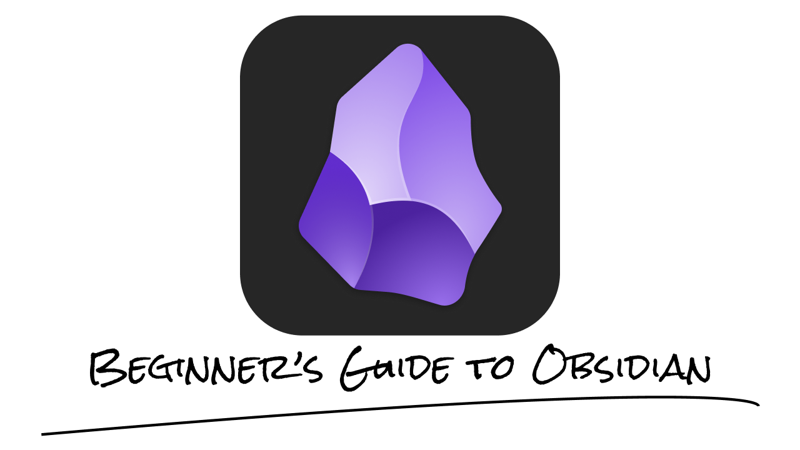

[English](README.md) | [Русский](README.ru.md)

# Что такое Obsidian и Markdown?

Obsidian — это не облачный сервис, а удобный и красивый интерфейс для работы с локальными текстовыми файлами Markdown (`.md`).

> [!NOTE]
> Основные плюсы:
> 1. По умолчанию заметки хранятся на вашем устройстве, поэтому для их создания не нужен интернет. Они не привязаны к учётной записи, но резервные копии всё равно нужны.
> 2. Заметки в Markdown — обычные текстовые файлы. Их удобно читать и сравнивать в системе контроля версий, потому что текст и разметка видны в самом файле. Подробнее о различиях с Word рассказано [в этом видео на YouTube](https://youtu.be/7a-YGcVG4_0?si=fE2bQnz8mPMC9bOP).
> 3. Контроль версий легко настроить, особенно с помощью GitHub: можно отследить, какая строка изменилась, какой файл был перемещён и многое другое.
> 4. У Obsidian есть много уникальных возможностей: ссылки на другие заметки, множество плагинов, самые разные темы и многое другое.

Но не стоит забывать, что всё это лишь для удобства ведения заметок, не более того. Не нужны заметки? Не нужно хранить информацию? Тогда закройте эту вкладку.

# Как пользоваться? Где изучить Markdown и возможности приложения?

Скачать Obsidian можно с официального сайта: [Download - Obsidian](https://obsidian.md/download)

Когда вы решитесь освоить Obsidian, советую пройти гайд от самих разработчиков. Цель гайда — научить вас работать в Markdown и показать некоторые уникальные фишки Obsidian. Если вас интересует что-то другое касательно Obsidian, то у вас всегда есть возможность посетить официальный сайт — [Home - Obsidian Help](https://obsidian.md/help/) или просто [Obsidian - Sharpen your thinking](https://obsidian.md/).

Для получения полного гайда вам потребуется либо в меню `Manage Vaults` найти `Sandbox Vault`, либо, если его там нет, открыть любую папку как `Vault`, а затем снизу в панели настроек найти знак вопроса, кликнув по которому, вы откроете меню с пунктом `Sandbox Vault`.

> [!TIP]
> Как оказалось, эти инструкции — не полный и, признаться честно, не лучший разбор возможностей Obsidian: уж больно простым языком всё рассказывается. Совершенно случайно мне попался разбор куда лучше, так сказать, уже для взрослых, но предназначенный изначально для обучения Gemini работе с приложением. Этот разбор я скачал с сайта плагина [Gemini Scribe](https://github.com/allenhutchison/obsidian-gemini/). В папке [bundled-skills](https://github.com/allenhutchison/obsidian-gemini/blob/master/prompts/bundled-skills) есть несколько заметок, но для человека полезна только эта четвёрка:
>
> - [Obsidian Flavored Markdown](guides_for_ai/obsidian-markdown.md) — базовый синтаксис, ссылки и эмбеды.
> - [Obsidian Properties](guides_for_ai/obsidian-properties.md) — работа со свойствами заметок (frontmatter).
> - [JSON Canvas](guides_for_ai/json-canvas.md) — бесконечный холст Obsidian.
> - [Obsidian Bases](guides_for_ai/obsidian-bases.md) — базы данных внутри приложения.
>
> Для изучения Obsidian достаточно прочитать первый файл, [obsidian-markdown](guides_for_ai/obsidian-markdown.md), в котором рассказывается самое главное. Остальное — уже на любителя.

Перед тем как начать составлять заметки, советую ознакомиться с моей [заметкой для "инициализации" Vault](docs/getting-started.ru.md).

# Что нужно, чтобы начать?

Чтобы уже сейчас начать работать с Obsidian, вам достаточно:
- изучить `Sandbox Vault` и/или [`obsidian-markdown`](guides_for_ai/obsidian-markdown.md)
- прочитать [мои must-have для начальных настроек приложения](docs/getting-started.ru.md#must-have)

# Более глубокое изучение

## Личные советы

### Версии файлов

Не знаю, будете ли вы хранить свой Vault в Git / GitHub / GitLab, но в любом случае сможете отслеживать версии с помощью встроенной функции Obsidian. Если перейти в `Settings` -> `Core Plugins` -> `File Recovery`, можно увидеть, что снимки `.md`-файлов создаются каждые 5 минут и хранятся неделю. Для любой заметки можно открыть снимок, нажав `View`. Эта функция особенно выручает, если файл уже удалён из системной корзины.

### Заголовки

Чтобы заметки было удобно читать, используйте заголовки. Например, нажмите на значок списка в правом верхнем углу, чтобы увидеть структуру текущей заметки. Заголовки — это must-have. Такое же меню, как здесь на GitHub, можно открыть и в Obsidian (значок из трёх полосок находится в правом верхнем углу).

### Callout-ы

Помимо заголовков можно использовать callout-ы. В `Sandbox Vault` о них уже рассказано, но там есть опечатки (или, возможно, это устаревшая версия). Ниже приведены готовые списки:
- [Callouts for GitHub](docs/callouts/github.ru.md)
- [Callouts for Obsidian](docs/callouts/obsidian.ru.md)

Важно: GitHub alerts отображаются и в Obsidian, но не все возможности callout-ов Obsidian работают на GitHub. Маркер GitHub alert не поддерживает собственный заголовок, поэтому вместо `>[!TIP] Мегасовет!` укажите только `>[!TIP]`, а дополнительный текст добавьте в тело alert. В Obsidian также можно сворачивать callout-ы с помощью `+` или `-` (например, `>[!note]-` или `>[!note]+`), но GitHub не поддерживает эти маркеры сворачивания.

Чтобы увидеть, как выглядят callout-ы Obsidian, сохраните эту заметку в свой Vault. Рекомендую использовать их пореже, чтобы не привыкать полагаться на возможности, которых нет на GitHub. Мне они понадобились только для публикации сайта на [Quartz](#публикация).

### Расположение файлов в дереве

Слева в дереве сначала располагаются папки, а затем файлы. Между собой они сортируются в порядке кодов из Unicode.

> [!TIP]
> **Как упорядочить файлы и папки по-своему?**
>
> Если вы хотите отправить какую-то папку на самый верх, то можете воспользоваться следующей упорядоченной цепью:
>
`!файл -> #файл -> @файл -> _файл -> 01_файл -> A_файл`
>
Также стоит отметить, что всякая английская буква младше всякой русской и что никто не мешает вам задать порядок следующим образом:
>
>`01_файл -> 02_файл -> ...`

> [!TIP]
> **Сохранение смысла заметок**
>
> Также многие на YouTube рекомендуют в каждой папке хранить главную заметку, которая опишет, что в текущей папке находится. Очень полезно, когда заметок становится так много, что не сыскать ни конца, ни начала. Аналог такого на GitHub — `README`-файлы.

### Hotkeys

Горячие клавиши (англ. **Hotkeys**) — отличный способ в разы ускорить работу за ноутбуком. Не игнорируйте их. Да, и без них можно обойтись, но ведь и без Obsidian вы могли бы обойтись.

> [!IMPORTANT]
> Горячих клавиш так много, что люди часто опускают руки, едва начав разбираться в них. Это понятно: их существуют сотни, если не тысячи. Но важно вот что: вам понадобится не больше 20. Об этом обычно никто не говорит.

Про них я написал в заметке [Hotkeys](docs/hotkeys.ru.md). Там же есть раздел [для Obsidian](docs/hotkeys.ru.md#obsidian).

> [!TIP]
> Главное сочетание клавиш в Obsidian — `Ctrl + E`: оно переключает между режимами чтения и редактирования.

## Web Clipper

Репозитории компании [Obsidian.md](https://github.com/obsidianmd) включают [obsidianmd/obsidian-releases](https://github.com/obsidianmd/obsidian-releases) с релизами приложения и большой проект [obsidianmd/obsidian-clipper](https://github.com/obsidianmd/obsidian-clipper). Перейдя по ссылке, вы откроете `README.md`, в котором будет пара слов о том, что вообще это за репозиторий, и будет выбор магазина для установки расширения в браузер. Из репозиториев Obsidian ещё есть [obsidianmd/obsidian-api](https://github.com/obsidianmd/obsidian-api), но его применение для меня пока остаётся загадкой — только если вы строите второй мозг по Карпатому (что, как мне кажется, дело бессмысленное) или что-то в этом духе.

Очень рекомендую это расширение, если вы часто видите страницу, содержание которой хочется сохранить себе на память — будь то важная статья о версионировании в современной индустрии или маленькая автобиография футболиста. Расширение позволит скачивать в формате `.md` весь текст сайта, поддерживая разделения по топикам и вписывая в начало заметки ссылку на сайт.

## Синхронизация

Чтобы синхронизировать свой Vault между устройствами или просто хранить где-то помимо вашего ПК, есть несколько вариантов:
1. Самый простой — через [Obsidian Sync](https://obsidian.md/help/sync) (4$ в месяц при оплате за год или 5$ в месяц при помесячной оплате).
2. Через Google, Яндекс или другой диск (цена только за ваш диск). Крайне рекомендую в таком случае прибегнуть к следующей архитектуре, чтобы не синхронизировать папку `.obsidian` (если не знаете, почему её и прочие скрытые папки не стоит синхронизировать, спросите у ИИ):
	- Папка Storage
		- Папка `.obsidian`
		- Папка для синхронизации с вашим диском
3. При помощи GitHub через создание private-репозитория (бесплатно). Для синхронизации между устройствами (в том числе мобильными) советую прочитать этот гайд (в нём будет также рассказано, как запускать коммиты автоматически и периодически): [Obsidian+GitHub вместо Notion: синхронизация, бекап и версионность (3-в-1) / Хабр](https://habr.com/ru/articles/843288/?ysclid=mrj9ut2748789300662).

Забавно, что чем дешевле вариант, тем он проще.

Спустя почти полгода активного пользования Obsidian для себя я решил разделить все свои файлы: вести заметки в Obsidian и синхронизировать через GitHub (3-м способом из вышеперечисленных), а все остальные файлы оставить на Google Диске. О том, почему не стоит использовать GitHub для всех-всех своих файлов, я рассказывать тут не стану, просто скажу, что:
1) GitHub блокирует обычные Git-файлы размером более 100 MiB; для таких файлов можно использовать Git LFS;
2) большие репозитории дольше клонировать. Мне особенно сложно работать с репозиториями больше 2 GB. GitHub рекомендует держать репозитории меньше 1 GB и настоятельно рекомендует не превышать 5 GB;
3) будет просто полезно разделить ваши файлы на «Для работы/учёбы/IT» и «Личное».

## Публикация

Obsidian хорош ещё и тем, что Vault можно опубликовать как сайт двумя способами:
- Напрямую через [Obsidian Publish](https://obsidian.md/help/publish) (8$ в месяц при оплате за год или 10$ в месяц при помесячной оплате).
- Через [Quartz](https://quartz.jzhao.xyz/) (бесплатно).

Второй способ довольно сложный, поэтому если вам и вправду нужно опубликовать заметки, советую воспользоваться моим уже [настроенным шаблоном](https://github.com/sergeypugin/quartz-ready-template) (пример того, как это будет выглядеть: https://sergeypugin.github.io/itmo-notebook/).

> Сама документация Obsidian — это и есть Vault, опубликованный на сайте. Перейдя по ссылкам, вы увидите, как будет выглядеть ваш Vault после публикации.